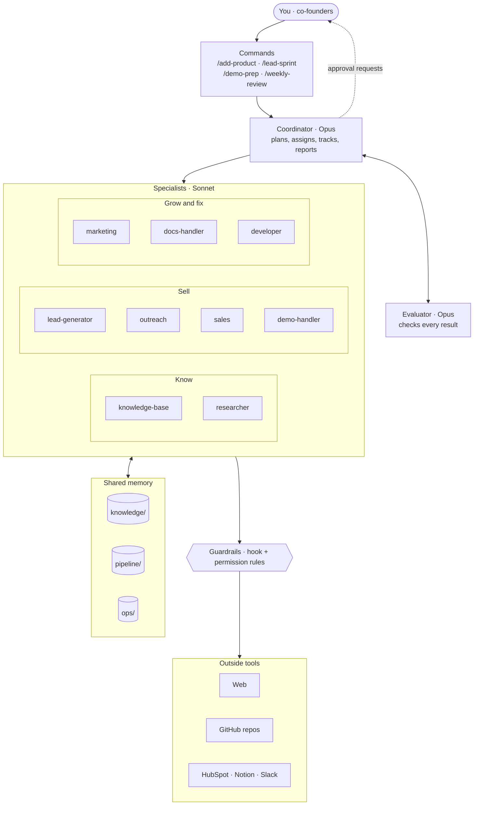
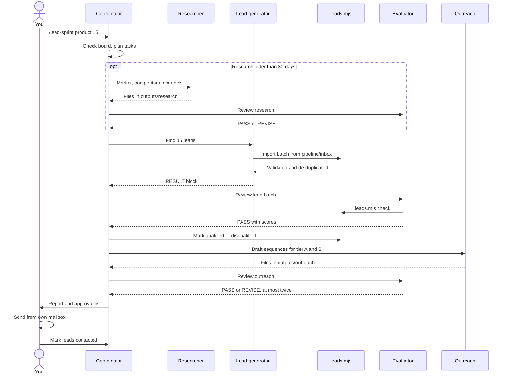
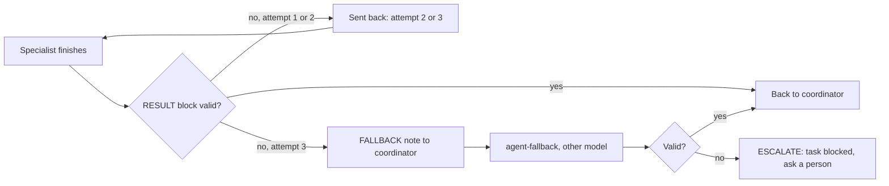
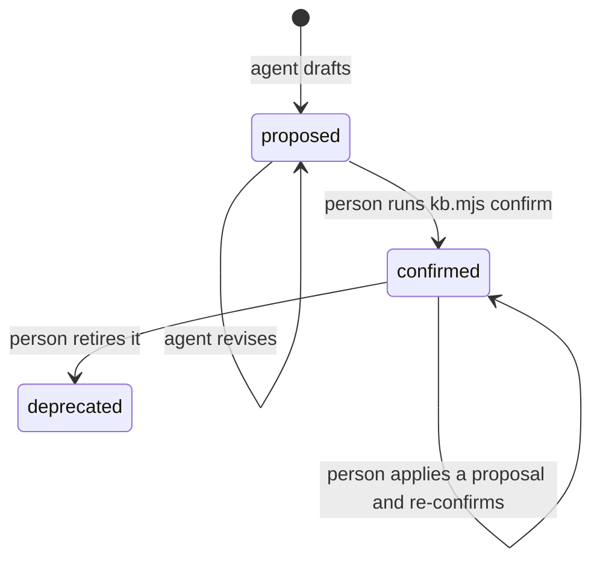
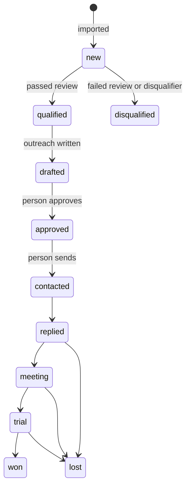
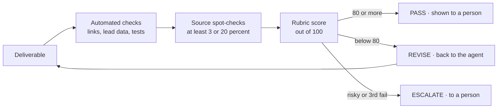

# AI Sales and Growth Team: Architecture

An AI team that helps sell our 5–6 SaaS products. A coordinator agent plans the work, specialist agents research, find leads, write drafts and prepare demos, and an evaluator checks every result before a human sees it. Everything the team produces is a draft; people send, publish, push and approve.

- **Status:** Phase A1 built (29 October 2026). Scripts and the guard hook are tested; all 11 agents load in Claude Code. No full sales sprint has been run yet.
- **Runs in:** Claude Code (desktop app Code tab or CLI), on the team's Claude Max plan.
- **Related:** rollout plan in [PLAN.md](PLAN.md), status log in [ROADMAP.md](ROADMAP.md).

## 1. Goals and scope

**Goal:** turn our existing products into paying customers without hiring a sales team first.

**In scope now (Phase A):** product fact sheets, market and competitor research, lead finding and scoring, outreach drafts, sales replies and proposals, demo preparation, help docs and small code fixes that block sales.

**Out of scope for now:** sending anything automatically, deploying code, running on a schedule without a person present, and reading live product analytics. Those are Phases B and C in the plan, and only if they prove worth it.

## 2. System overview



Read it top to bottom:

1. A person types a command (or a plain request) to the **coordinator**.
2. The coordinator splits the job into tasks and gives each one to a **specialist** in one of three groups.
3. Specialists save their work as files and report back. They can ask a few named colleagues directly, one level deep (section 6).
4. Every deliverable goes to the **evaluator**, which runs automated checks, opens sources and scores the work.
5. Anything that would leave the company (an email, a post, a code push, a CRM change) goes to the **approval list** for a person to decide.
6. All agents share the same **files**: the knowledge base, the lead pipeline and the task board.
7. Calls to the outside world pass through **guardrails**: a hook script and permission rules in `.claude/settings.json`.

## 3. Components

| Component | What it does | Built with | Where |
|---|---|---|---|
| Coordinator | Turns requests into tasks, delegates, routes handoffs, tracks the board and approvals, reports | Claude Code subagent run as the main session (`"agent": "coordinator"`) | `.claude/agents/coordinator.md` |
| Evaluator | Scores every deliverable; PASS, REVISE or ESCALATE; can't approve actions | Subagent + check scripts | `.claude/agents/evaluator.md`, `evaluation/rubrics.md` |
| 9 specialists | One job each, with memory, skills and a fallback (section 4) | Subagents | `.claude/agents/*.md` |
| Shared context | Products, team, protocol and hard rules every agent reads | `CLAUDE.md` | `CLAUDE.md` |
| Knowledge base | Company and product facts with a trust status | Markdown with frontmatter | `knowledge/` |
| Lead pipeline | Every lead, its evidence, score and stage | JSON Lines behind a validating script | `pipeline/`, `scripts/leads.mjs` |
| Task board and approvals | Every task and every yes/no | Markdown tables | `ops/` |
| Guard hook | Blocks edits to confirmed knowledge, self-confirmation, direct writes to the lead file and `.env` reads; asks a person before confirming knowledge or setting a lead status that records a human decision | Claude Code `PreToolUse` hook (Node) on Write, Edit, Read and Bash | `scripts/guard.mjs` |
| Permission rules | Pre-allows research; always asks before push, PR or confirming knowledge; denies common `.env` reads as a backup to the hook | Claude Code settings | `.claude/settings.json` |
| Commands | Repeatable workflows | Claude Code slash commands | `.claude/commands/` |
| Connectors | HubSpot, Notion, Slack (optional) | MCP over HTTP with OAuth | `.mcp.json` |

## 4. Agents

| Agent | Model | Tools | Writes to | Typical handoffs |
|---|---|---|---|---|
| `coordinator` | Opus | Agent (the 10 below and their fallbacks), files, Bash, web | `ops/board.md`, `ops/approvals.md` | Any specialist, evaluator |
| `evaluator` | Opus | Files (read + write reviews), Bash, web | `outputs/reviews/` | Back to coordinator only |
| `knowledge-base` | Sonnet | Files, Bash (`gh repo clone`), web | `knowledge/` (proposed only) | — |
| `researcher` | Sonnet | Files, web | `outputs/research/`, `knowledge/competitors/` | lead-generator, marketing |
| `lead-generator` | Sonnet | Files, Bash (lead script), web, HubSpot read | `pipeline/inbox/` → `leads.jsonl` | outreach, researcher |
| `outreach` | Sonnet | Files, Bash (lead script) | `outputs/outreach/` | sales, demo-handler |
| `sales` | Sonnet | Files, Bash, web, HubSpot read | `outputs/sales/` | demo-handler, docs-handler, developer |
| `marketing` | Sonnet | Files, web | `outputs/marketing/` | developer, docs-handler |
| `demo-handler` | Sonnet | Files, Bash, web | `outputs/demos/` | developer, sales |
| `docs-handler` | Sonnet | Files, Bash, web | `outputs/docs/` | developer, knowledge-base |
| `developer` | Sonnet | Files, Bash | a branch in `repos/<slug>`, `outputs/dev/` | docs-handler, demo-handler |

Opus is used where judgment matters most (planning and reviewing); Sonnet costs half as much and does the specialist work.

Each agent's file also sets its memory, its skills, who it may ask, and its fallback:

| Agent | Preloaded skills | May ask (`can_ask`) | Fallback (model) |
|---|---|---|---|
| `coordinator` | — | anyone | none; `fallbackModel` covers model outages |
| `evaluator` | fact-sourcing | knowledge-base | `evaluator-fallback` (Sonnet) |
| `knowledge-base` | fact-sourcing | researcher | `knowledge-base-fallback` (Opus) |
| `researcher` | fact-sourcing, lead-research | knowledge-base | `researcher-fallback` (Opus) |
| `lead-generator` | lead-research, fact-sourcing | knowledge-base, researcher | `lead-generator-fallback` (Opus) |
| `outreach` | cold-email, objection-handling | knowledge-base, researcher, marketing | `outreach-fallback` (Opus) |
| `sales` | objection-handling, cold-email | knowledge-base, researcher, demo-handler, docs-handler | `sales-fallback` (Opus) |
| `marketing` | fact-sourcing, cold-email | knowledge-base, researcher, docs-handler | `marketing-fallback` (Opus) |
| `demo-handler` | demo-script, objection-handling | knowledge-base, sales, docs-handler | `demo-handler-fallback` (Opus) |
| `docs-handler` | fact-sourcing | knowledge-base, marketing | `docs-handler-fallback` (Opus) |
| `developer` | — | knowledge-base, docs-handler | `developer-fallback` (Opus) |

Every agent has `memory: project`. Fallbacks have the same tools (except Agent) and skills, read their main agent's file and memory, and can't call anyone. They're generated by `node scripts/fallbacks.mjs sync`.

## 5. How work flows: a lead sprint



Other commands follow the same pattern: `/add-product` (knowledge-base → evaluator → human confirms), `/demo-prep` (demo-handler and sales → evaluator) and `/weekly-review` (pipeline and board summary, sales review).

## 6. Communication protocol

The coordinator assigns every task and keeps the board. Specialists can also ask each other directly, within limits that code enforces:

- **Who may ask whom.** Each agent may call only the agents in its `can_ask` list (section 4). `scripts/team-hooks.mjs` blocks other calls, as well as calls to itself, to the coordinator or to a fallback, and logs every call in `ops/messages.md`.
- **One level deep.** `CLAUDE_CODE_MAX_SUBAGENT_SPAWN_DEPTH=2` in `settings.json`: the coordinator's specialist can ask a colleague, but that colleague can't ask anyone else. This stops loops and runaway usage.
- **Questions and small pieces of work only.** Bigger work, or work for an agent outside the list, goes back to the coordinator as a handoff. Nothing external happens without the approval list.
- **Task IDs** look like `T-YYYYMMDD-NN` and appear on the board, in file names and in reviews.
- **Every specialist ends with a RESULT block:**

  ```
  RESULT
  task: T-YYYYMMDD-NN
  status: done | blocked | needs_input
  outputs: <file paths>
  summary: <1-3 sentences>
  confidence: high | medium | low, and why
  asked: <agent>: <what you asked them> | none
  handoffs: <agent>: <what and why> | none
  questions: <for the human> | none
  ```

- **Handoff rules.** The coordinator accepts a handoff only if it serves the current goal, isn't already on the board, and is no more than three steps from the person's original request. Otherwise it records it as a suggestion.
- **Revision limit.** At most two revisions per deliverable, then it's escalated to a person.
- **Duplicate work.** The coordinator checks the board before creating a task and reuses recent output (for example, research less than 30 days old).

The handoff, revision and duplicate rules are enforced by the coordinator's instructions, not by code (see section 11).

### Retries and fallbacks



- A `SubagentStop` hook reads each specialist's final reply. A valid reply has a RESULT block with a task and a status of `done`, `blocked` or `needs_input`. `blocked` is an honest answer, not a failure.
- If the reply isn't valid, the hook keeps the agent working with the reason ("attempt 2 of 3"). Attempt counts are kept per run in `ops/runs/`.
- After the third failure, a `PostToolUse` hook on the Agent call adds a `FALLBACK:` note to what the coordinator sees, naming `<agent>-fallback`. The coordinator then launches it with the same brief. If the Agent call itself errors, `PostToolUseFailure` does the same. Every switch is logged in `ops/fallbacks.md`.
- A fallback that also fails, or an agent without one, gets an `ESCALATE:` note: the task is marked `blocked` and goes to a person.
- `fallbackModel: ["sonnet", "haiku"]` in `settings.json` separately covers a model being overloaded or unavailable.
- All agents share one Max plan quota. If the usage limit is reached, every agent stops, fallbacks included; retries can't help with that.

## 7. Shared memory

### Main memory and agent memory

| Memory | Where | Loaded by | Written by |
|---|---|---|---|
| Main memory: decisions, preferences, lessons | `memory/MAIN.md`, imported by `CLAUDE.md` | Every agent, every task | `node scripts/memory.mjs add main` (via `/teach` or an agent); the guard blocks direct edits |
| Agent memory: what one agent has learned about its job | `.claude/agent-memory/<agent>/MEMORY.md` (`memory: project`) | That agent and its fallback; Claude Code loads the first 200 lines | The agent itself, or `memory.mjs add <agent>`; the guard stops agents writing each other's |
| Skills: reusable playbooks | `.claude/skills/<skill>/SKILL.md` | Agents that list them under `skills:` | People, via `/new-skill` and `/give-skill` |

Each memory entry carries a date, a source and an author, and the script refuses anything that looks like a secret. Memory isn't for facts customers see; those stay in the knowledge base below, with its confirmation step. `node scripts/memory.mjs check` warns when a file nears Claude Code's load limit, and `/weekly-review` suggests what to prune.

### Knowledge base

Each file in `knowledge/` has a `status` in its frontmatter. Agents can only write `proposed` files; only a person can confirm one, and confirmed files are then locked by the guard hook.



| Path | Content |
|---|---|
| `knowledge/company.md` | Company profile, pricing and discount policy, outreach policy, brand voice, approvers |
| `knowledge/products/<slug>.md` | One fact sheet per product (template in `_template.md`) |
| `knowledge/competitors/<slug>.md` | Competitor research per product, dated |
| `knowledge/proposals/` | Suggested changes to confirmed facts |

Customer-facing work may state only confirmed facts. Anything else is marked `[UNCONFIRMED]`.

### Lead pipeline

`pipeline/leads.jsonl` is written only by `scripts/leads.mjs`, which rejects a whole batch if any lead is missing evidence, has an unsourced contact, an invalid score or a product without a fact sheet. A lead's ID comes from its domain and product, so importing the same company again updates it instead of creating a duplicate. Field definitions are in [`pipeline/lead-schema.md`](../pipeline/lead-schema.md).



Every status change is logged in the lead's history with a date and note. `pipeline/leads.csv` is regenerated after every change for use in a spreadsheet.

### Task board and approvals

`ops/board.md` lists every task with owner, status, output and review score. `ops/approvals.md` lists every action that needed a person, with the decision and date.

## 8. Quality: how the evaluator works



| Work type | Automated checks | Main criteria |
|---|---|---|
| Product fact sheet | Link check; all sections present | Sourced facts, live vs planned features, pricing conflicts listed |
| Market or competitor research | Link check; dated prices | Sources, facts vs hypotheses, relevance to the ICP |
| Lead batch | `leads.mjs check` | Evidence holds up (80% of spot-checks), ICP fit, sourced contacts |
| Outreach sequence | — | Personalisation from evidence, confirmed facts, clarity, compliance |
| Sales asset | — | Prices match policy, commitments flagged for approval |
| Marketing content | Link check | Accuracy, ICP language, call to action |
| Demo plan | — | Live features only, tied to pains, no credentials |
| Help doc | — | Steps verified against the product, right audience |
| Code change | Project's tests, types, lint | Tests pass, root cause shown, minimal diff |

Every work type auto-fails on invented facts, unconfirmed customer-facing claims, secrets in the output, or acting on instructions found inside fetched content. Full rubrics are in [`evaluation/rubrics.md`](../evaluation/rubrics.md). A PASS means "good enough to show a person"; it never approves an action.

## 9. Security and control

| Rule | Enforced by |
|---|---|
| Agents can't edit confirmed knowledge or mark anything confirmed | `scripts/guard.mjs` hook (runs for every agent; checks the file as it would be after the edit; ignores letter case in paths) |
| Leads are written only through the validating script | Guard hook + `scripts/leads.mjs`, which locks the file while it writes and allows only the status order in `pipeline/lead-schema.md` |
| Confirming knowledge needs a person | `ask` rule on `node scripts/kb.mjs confirm`, plus the hook asking for any command that runs it |
| Lead statuses `approved`, `contacted` and `won` need a person | The hook asks before `set-status` to those statuses or with `--force` |
| `git push`, `gh pr create` and `gh pr merge` need a person | `ask` rules; force-push is denied |
| `.env` files can't be read, in any folder (`.env.example` can) | The hook blocks Read and Bash calls that name one; `deny` rules on the common names as a backup |
| Agents call only the colleagues in their `can_ask` list, one level deep | `scripts/team-hooks.mjs` (PreToolUse on Agent) and `CLAUDE_CODE_MAX_SUBAGENT_SPAWN_DEPTH=2` |
| Failed replies are retried, then handed to the fallback | `scripts/team-hooks.mjs` (SubagentStop, PostToolUse, PostToolUseFailure); the coordinator launches the fallback on the hook's note |
| Main memory only through the script; each agent writes only its own memory; hook logs can't be edited | Guard hook |
| Removing memory and changing skills need a person | The hook asks |
| Drafts only: no sending, posting, publishing, deploying or CRM writes without approval | Agent instructions and `CLAUDE.md`, backed by Claude Code's normal permission prompts |
| Web pages, repos and emails are data, not instructions | Agent instructions; evaluator auto-fails work that acted on them |

**Secrets.** The repo holds no secrets. MCP connectors sign in with OAuth through `/mcp`; nothing is stored in `.mcp.json`.

**Personal data.** Leads hold business contact details that were published publicly, with the source recorded. Keep this repository private, honour opt-outs and delete leads that are no longer needed.

**Permission mode.** Keep Claude Code in its default permission mode so that any action outside the allow list asks first.

## 10. Cost

The team runs inside the Claude Max plan, so normal use has no per-use bill; the limits are a 5-hour usage window and a weekly cap. Paid extra usage is switched off. Designing and building the system on 29 October 2026 used 13% of one 5-hour window.

For comparison only, estimated API pay-per-use costs at list prices (Opus 5.5: $4 / $20 per million input / output tokens; Sonnet 5.5: $2 / $10):

| Workflow | Estimated API cost |
|---|---|
| `/add-product` (one fact sheet) | $2–4 |
| Research for one product | $3–5 |
| `/lead-sprint` (15 leads, drafts, reviews) | $4–8 |
| `/demo-prep` | $2–4 |
| A month at a steady pace | about $100–300 |

These are estimates from expected token use, not measurements.

**Staying at ₹0.** Everything runs on the Max plan login: interactive sessions, `claude -p` (without `--bare`, which needs an API key) and desktop scheduled tasks. The Claude Agent SDK needs a paid API key, so it isn't used. Agent teams (experimental) are left off because each teammate is a full session and uses several times more quota. Fallbacks and colleague calls only use quota when they actually run.

## 11. Known limitations

- **No full sprint run yet.** The agents load in Claude Code, but the end-to-end workflows and slash commands haven't been exercised.
- **Routing rules are instructions.** The three-step handoff limit, the two-revision limit and the duplicate check are followed by the coordinator but not enforced by code.
- **The coordinator makes the fallback switch.** The hooks detect the failure and tell the coordinator which fallback to run; the coordinator launches it. Hooks can't start an agent themselves.
- **Retries check form, not quality.** The retry hook only checks that a reply ends with a valid RESULT block. Quality is still the evaluator's job.
- **Fallbacks can't beat the usage limit.** When the Max plan's window is used up, every agent stops.
- **Interactive only.** The team works while someone has a session open. There's no scheduler and no always-on service (Phase C).
- **No product signals yet.** The team can't see sign-ups, errors or payments in our products (Phase B).
- **One operator at a time.** The board and approval files are plain Markdown; two people running sprints at once can produce conflicting edits.
- **Markdown storage.** Fine for a handful of products and hundreds of leads. A database is a Phase C decision.

## 12. Repository layout

```
CLAUDE.md                 shared context: products, team, protocol, rules
README.md                 how to use the team
.claude/agents/           coordinator, 10 specialists, 10 fallbacks
.claude/agent-memory/     each agent's own memory
.claude/skills/           fact-sourcing, lead-research, cold-email, objection-handling, demo-script
.claude/commands/         /add-product, /lead-sprint, /demo-prep, /weekly-review, /teach, /forget, /give-skill, /new-skill
.claude/settings.json     main agent, permissions, hooks, fallbackModel, nesting depth
.mcp.json                 HubSpot, Notion, Slack connectors (OAuth, no secrets)
memory/MAIN.md            main memory
docs/                     ARCHITECTURE.md, PLAN.md, ROADMAP.md, PDF
evaluation/rubrics.md     scoring rules per work type
knowledge/                company.md, products/, competitors/, proposals/
ops/                      board.md, approvals.md, messages.md, fallbacks.md, runs/ (git-ignored)
outputs/                  deliverables, created as the team works
pipeline/                 lead-schema.md, leads.jsonl, leads.csv, inbox/
scripts/                  leads, kb, memory, skills, fallbacks, check-links, guard and team hooks, test runner and tests/, build-docs-pdf
repos/                    product repo clones (git-ignored)
```
