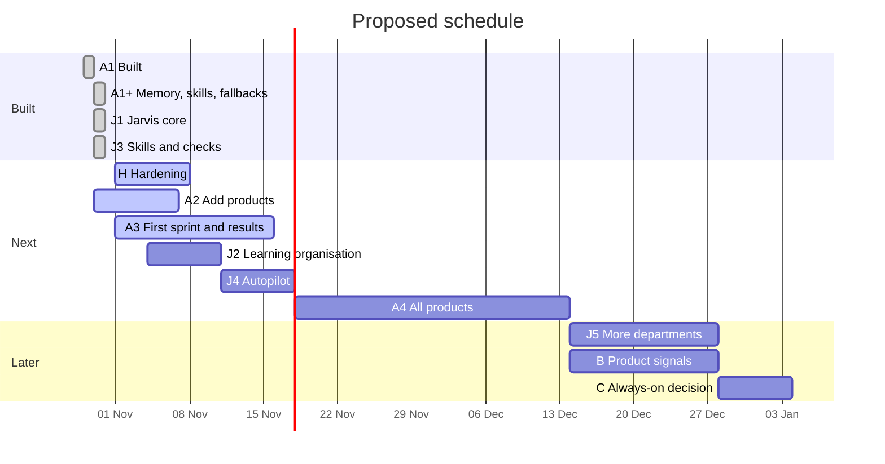

# AI Sales and Growth Team: Rollout Plan

How we go from "built" to paying customers, one phase at a time. Each phase has tasks, an owner and a test that says when it's done; we don't start the next phase until that test passes. How the system works is in [ARCHITECTURE.md](ARCHITECTURE.md); progress is logged in [ROADMAP.md](ROADMAP.md).

Dates are proposals. Names in `[brackets]` are for the team to fill in.

## Phases at a glance

| Phase | Goal | Status / when | Done when |
|---|---|---|---|
| A1 · Built | The team, knowledge base, lead pipeline, checks and guardrails exist | ✅ Done, 29 Oct 2026 | Scripts and hook tested; agents load |
| A1+ · Memory, skills, fallbacks | Main and per-agent memory, skills, direct agent calls, retries and fallback agents | ✅ Done, 30 Oct 2026 | Tests pass; a live run shows the hooks working |
| J1 · Jarvis core | Hand over any task with `/do` or `jarvis.mjs`; it runs the whole chain and returns a finished result and report; task queue; plan-usage guard; lessons recorded after each task | ✅ Done, 30 Oct 2026 | A real task runs end to end from one command, with a report and recorded lessons |
| H · Hardening | Fix what live tests exposed: stronger copy checks and lead gate, hold state, corrected records, site and positioning fixes | 🟡 Build done 1 Nov 2026; waiting on people | Open decisions answered, company details filled in, site fixes merged |
| A2 · Add products | Confirmed fact sheets for our 5–6 products | 🟡 1 of 5–6 (MotionRepo, 30 Oct) | Every fact sheet confirmed |
| A3 · First sprint | 15 leads and outreach for one product, run through Jarvis; measure results | 🟡 Waiting on people: 3 leads qualified and 2 email sequences passed review; nothing sent | Sprint passes review; results recorded |
| J2 · Learning organisation | Feed company documents into knowledge and memory; turn work scoring 90+ into skills (gate-log mining is done) | After A3 | Org documents ingested; first skill mined from real work |
| J3 · Skill library and checks | 13 new skills, 5 upgraded, automatic copy checks, opt-out list and lead gate, adapted from open-source marketing repos | ✅ Done, 30 Oct 2026 | Every selling agent preloads 3+ skills; checks pass on reviewed work with no false alarms |
| J4 · Autopilot | Daily queue run and weekly review as desktop scheduled tasks, on the Max plan | After J3 | A week of scheduled runs with reports and no lost tasks |
| A4 · All products | A weekly selling rhythm across every product | After J4 | Every product sprinted; 4 weekly reviews |
| J5 · More departments | Support, hiring, ops, built the same way: agent, skills, fallback, rubric | When wanted | First new department passes a live task |
| B · Product signals | The team can see sign-ups, errors and payments, read-only | Only if A4 shows we need it | One product's funnel answered with real numbers |
| C · Always-on system | A database and a dashboard; scheduling itself is now J4 | Only if needed | Go / no-go decision with costs |

## Phase J1 · Jarvis core (done, 30 Oct 2026)

| # | What | Where |
|---|---|---|
| 1 | `/do <task>`: the coordinator runs the whole chain on autopilot, with no questions mid-way, and ends with a report | `.claude/commands/do.md`, "Autopilot" in `.claude/agents/coordinator.md` |
| 2 | `node scripts/jarvis.mjs add / do / run / list / cancel / usage`: queue tasks and run them one by one as headless coordinator sessions on the Max plan | `scripts/jarvis.mjs`, `ops/queue.md` |
| 3 | Usage guard: no task starts while a plan window is at or over 85% (`JARVIS_STOP_AT`); a task the limit cuts off goes back in the queue | `ops/runs/plan-limits.json` |
| 4 | After-task review: review fixes and fallback switches become lessons in the agent's memory | Autopilot step 5 |
| 5 | Reports with the result, files, approvals, questions, assumptions, lessons and next tasks | `outputs/reports/<id>.md` |
| 6 | Tests (fake Claude) and a live run: a battlecard passed at 95/100 after two revisions, and 4 lessons were recorded | `scripts/tests/jarvis.test.mjs`, `outputs/reports/J-20261030-01.md` |

**Still to do by a person:** to let autopilot developer tasks make local commits and run tests, add the local git and test commands to the allow list in `.claude/settings.json` (see ROADMAP blockers).

## Phase J3 · Skill library and checks (done, 30 Oct 2026)

| # | What | Where |
|---|---|---|
| 1 | Automatic checks before review: banned words, placeholders, unsourced numbers, external actions, cold-email rules, social and SEO | `scripts/lint-copy.mjs`, `evaluation/voice-rules.json` |
| 2 | Gate log, and mining of repeat failures into candidate lessons | `ops/gate-log.jsonl`, `lint-copy.mjs mine` |
| 3 | Global opt-out list and a Go, Conditional or Stop lead gate; evidence signal classes | `scripts/leads.mjs`, `pipeline/lead-schema.md` |
| 4 | 13 new skills and 5 upgraded, 18 in all | `.claude/skills/`, credited in `docs/CREDITS.md` |
| 5 | Agents, rubrics, the coordinator and `/weekly-review` use all of the above; outcomes are declared before drafting | `.claude/agents/`, `evaluation/rubrics.md` |
| 6 | 170 tests; the checks ran clean on the reviewed battlecard and market brief | `scripts/tests/` |

## Phase H · Hardening (build done 1 Nov 2026, waiting on people)

| # | What | Where | Status |
|---|---|---|---|
| 1 | Copy checks cover every email, stop each email at the next heading, and warn on two questions. They found Repowise's Email 2 at 122 words | `scripts/lint-copy.mjs` | ✅ Done |
| 2 | The lead gate shows Not reviewed instead of Go, and flags old signals and evidence with no signal class | `scripts/leads.mjs` | ✅ Done |
| 3 | `hold`, `release`, `supersede` and `next` for lead records; Repowise is on hold | `scripts/leads.mjs`, `pipeline/lead-schema.md` | ✅ Done |
| 4 | Skills corrected from the live tests | `.claude/skills/cold-email/`, `.claude/skills/lead-research/` | ✅ Done |
| 5 | `/security`, README and the pricing comment corrected. The frontend type check passes; the backend tests need app credentials and weren't run | [Collateral-Pipeline PR #42](https://github.com/PanScienceInnovation/Collateral-Pipeline/pull/42), branch `agent/T-20261101-01` | 🟡 Waiting: review, merge and deploy |
| 6 | Positioning proposal for the "one run" claim, passed at 92/100 | `knowledge/proposals/2026-11-01-motionrepo-one-run-positioning.md` | 🟡 Waiting: a person applies it |
| 7 | 190 tests pass | `scripts/tests/` | ✅ Done |

**Still to do by a person:**

- [x] Decide whether "never contact competitors" covers Repowise (A-20261030-02). Claude decided yes for shivam-G05, and a person can reverse it.
- [ ] Fill in the company details in `knowledge/company.md` and confirm it again.
- [ ] Check whether the billing Hub adds GST, then review, merge and deploy PR #42. Its Plan page wording now holds either way.
- [ ] Apply the positioning proposal and confirm the fact sheets again.
- [ ] Review and merge [PR #5](https://github.com/Mohitclan/AGENTS-AGENTS-AND-AGENTS-/pull/5).

## Phase J2 · Learning organisation

| # | Task |
|---|---|
| 1 | A `knowledge/org/` inbox: drop brand guides, past proposals, sales emails and SOPs; knowledge-base turns them into proposed facts and memory lessons |
| 2 | `/ingest <folder or URL>` command, and optional GitHub and Notion sources |
| 3 | Skill mining: work scoring 90+ is turned into a candidate skill for a person to approve |
| 4 | `/weekly-review` prunes stale memory and reports which lessons stopped repeat mistakes |

**Done when:** at least five organisation documents are ingested and confirmed, and one skill has been mined from real work.

## Phase A2 · Add the products (week of 2 Nov)

| # | Task | Owner | Status |
|---|---|---|---|
| 1 | Create a private GitHub repo and push this folder | [name] | ✅ Done |
| 2 | Fill in `knowledge/company.md` (pricing and discount policy, outreach policy, voice, approvers), then confirm it with `node scripts/kb.mjs confirm knowledge/company.md` | [name] | 🟡 Part done: confirmed, but company details are placeholders |
| 3 | List the 5–6 products with website and repo | [name] | 🟡 Waiting: MotionRepo listed, a person names the rest |
| 4 | Run `/add-product <name> <website> <owner/repo>` for each product | [name] | 🟡 Part done: MotionRepo only |
| 5 | Review each fact sheet, answer its open questions, then confirm it | Product owner for each | 🟡 Part done: MotionRepo only |
| 6 | Optional: set up a separate domain and mailbox for outreach | [name] | ⬜ Not started |

**Done when**

- [ ] `node scripts/kb.mjs status` shows `knowledge/company.md` and every product file as `confirmed`. (MotionRepo and company confirmed; other products not added)
- [ ] Each fact sheet passed review with a score of 80 or more, and no pricing conflicts are left open. (MotionRepo passed at 93/100; other products not added)
- [x] `/agents` lists all 21 agents (coordinator, ten specialists, ten fallbacks), a new session in the repo starts as the coordinator, and `node scripts/test.mjs` passes.

## Phase A3 · First lead sprint (weeks of 9 and 16 Nov)

**Where it stands, 1 Nov 2026: waiting on people.** Nothing sent, and nobody contacted.

- **Candidates:** 20 checked across the sprint, the solo re-test and the re-run.
- **Tests:** solo founders now count (shivam-G05). Claude also loosened three tests for the re-run: a launch in the last 30 days passes, a demo video lowers the score instead of rejecting, and an active GitHub account counts as inferred evidence. A person can reverse these.
- **Leads:** Pippin, Graphite and SpaceWise passed review. Cool Analytics is on hold.
- **Drafts:** Pippin and Graphite have three-email sequences that passed at 87/100 on the second review.
- **Main risk:** none of the leads shows product code on GitHub, so Email 1 asks.

**Next:** a person fills in the sender details, confirms https://motionrepo.panscience.ai and /security load, and approves sends A-20261101-03 to -08. They timed out from the machine running the team on 1 Nov.

| # | Task | Owner | Status |
|---|---|---|---|
| 1 | Pick the first product: the one with the clearest buyer and a sign-up and checkout that work | Founders | ✅ Done: MotionRepo |
| 2 | Run `/lead-sprint <product-slug> 15` | [name] | 🟡 Part done: 3 of 15 leads qualified |
| 3 | Read the approval list in `ops/approvals.md`; send the approved emails ourselves; mark each lead `contacted` | [name] | 🟡 Waiting: sender details and approvals |
| 4 | Paste replies to the coordinator; use `/demo-prep <lead-id>` for any meeting | [name] | ⬜ Not started |
| 5 | Run `/usage` after the sprint and note how much of the 5-hour window it used | [name] | ⬜ Not started |
| 6 | After two weeks, record the results in `docs/ROADMAP.md` | [name] | ⬜ Not started |

**Done when**

- [ ] 15 leads were imported and `node scripts/leads.mjs check` passes.
- [ ] The lead batch and the outreach drafts each passed review within two revisions.
- [ ] Every email we sent has a row in `ops/approvals.md`, and its lead is marked `contacted`.
- [ ] The metrics below are recorded for this sprint.

## Phase A4 · All products (16 Nov – 11 Dec)

| # | Task | Owner |
|---|---|---|
| 1 | One or two lead sprints a week, rotating through the products | [name] |
| 2 | `/weekly-review` every Friday; agree next week's focus | Founders |
| 3 | Marketing: positioning and a landing-page audit for each product | [name] |
| 4 | Docs: a getting-started guide for each product | [name] |
| 5 | Developer: fix the top blockers that come up in sales conversations (on branches, reviewed by us) | [name] |

**Done when**

- [ ] Every product has had at least one lead sprint and one landing-page audit.
- [ ] Four weekly reviews have run.
- [ ] We've decided, from the numbers, which products to focus on.

## Phase B · Product signals (only if needed)

**Start only if** A4 keeps hitting questions we can't answer without product data: where sign-ups drop off, why payments fail, which errors users hit.

| # | Task |
|---|---|
| 1 | List, per product, what exists: analytics, error tracking, logs, billing, support inbox |
| 2 | Give the team read-only access for one product first, through official APIs or MCP connectors |
| 3 | Add a product-health command and a monitoring agent that reports drops with evidence, never guesses |

**Done when:** for one product, the team can answer "where do sign-ups drop off this week?" with sourced numbers, using read-only access.

## Phase C · Always-on system (only if needed)

**Start only if** we need work to run without a person present (scheduled research, alerts), several people running the team at once, or a dashboard.

| # | Task |
|---|---|
| 1 | Research current runtime options against official docs: for example the Claude Agent SDK, Claude Managed Agents, or a workflow engine with our own agent loop |
| 2 | Estimate API costs. This runs on an API key, billed per use and separate from the Max plan |
| 3 | Design the move from Markdown files to a database, and a dashboard for tasks, approvals and cost |

**Done when:** we have a go or no-go decision with a cost estimate.

## Metrics

| Metric | How we measure it | Target |
|---|---|---|
| Leads per sprint | `node scripts/leads.mjs list` | 15 |
| Leads that hold up in review | Evaluator spot-checks | 80% or more |
| Deliverables passing review first time | `outputs/reviews/` | [target] |
| Reply rate | replied ÷ contacted | [target] |
| Meetings booked | Leads at `meeting` | [target] |
| Trials and paying customers | Leads at `trial` and `won` | [target] |
| Our time per sprint | Our own log | 60 minutes or less |
| Plan usage per sprint | `/usage` | Recorded |

## Decisions needed

| Decision | Options | Decided by | By when |
|---|---|---|---|
| Start Phase A | Yes or no | Founders | Next meeting |
| First product | One of our products | Founders | Next meeting |
| Who approves what | Sending, publishing, code, discounts | Founders | Next meeting |
| Outreach mailbox | Separate domain or main domain | [name] | Week of 2 Nov |
| Where the repo lives | Personal account or company organisation | [name] | Week of 2 Nov |
| Segment 1 launch, video and GitHub tests | Keep Claude's loosened tests, or reverse them | shivam-G05 | Before the first send |
| Maker's other product | Does "never contact competitors" cover it? Decides Cool Analytics and Know why it broke | shivam-G05 | Before the next sprint |
| SpaceWise contact | Allow a draft by X, or find another published contact | shivam-G05 | Before the next sprint |

## Risks and how we handle them

| Risk | What we do |
|---|---|
| Outreach lands in spam or hurts our main domain | Separate domain, low daily volume, an opt-out line in every email |
| Wrong or invented claims reach a prospect | Only confirmed facts in customer-facing work; evaluator auto-fails invented facts; a person approves every send |
| Privacy and anti-spam rules | Public business information only, sources recorded, opt-outs honoured, stale leads deleted; check the rules for each country we email (for example GDPR for EU contacts) |
| Hitting Max plan limits | Smaller batches, a fresh session per task, switch the coordinator to Sonnet if needed |
| A bad code change | Branches only, tests required, push and PRs need a person, we review every PR |
| Two people editing the board at once | One person runs each sprint; commit after each sprint |
| Leaning on the AI for relationships | Founders own every customer conversation; the team only prepares drafts |

## First session checklist

1. Clone the repo and open it in the Claude desktop app's Code tab, or run `claude` in it.
2. Check the agents loaded: `/agents`.
3. Fill in and confirm `knowledge/company.md`.
4. Run `/add-product` for the first product and review its fact sheet.
5. Run `/lead-sprint <product-slug> 15`.
