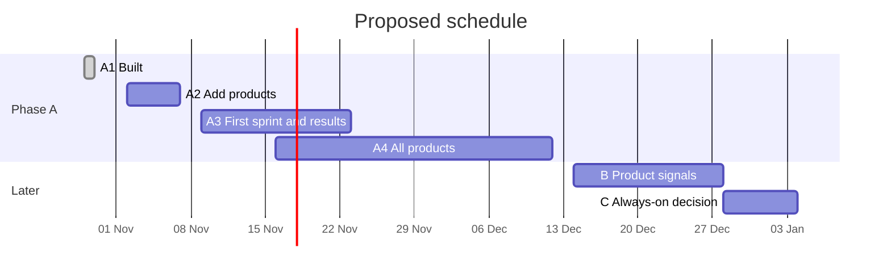

# AI Sales and Growth Team: Rollout Plan

How we go from "built" to paying customers, one phase at a time. Each phase has tasks, an owner and a test that says when it's done; we don't start the next phase until that test passes. How the system works is in [ARCHITECTURE.md](ARCHITECTURE.md); progress is logged in [ROADMAP.md](ROADMAP.md).

Dates are proposals. Names in `[brackets]` are for the team to fill in.

## Phases at a glance

| Phase | Goal | When (proposed) | Done when |
|---|---|---|---|
| A1 · Built | The team, knowledge base, lead pipeline, checks and guardrails exist | Done, 29 Oct 2026 | Scripts and hook tested; agents load |
| A2 · Add products | Confirmed fact sheets for our 5–6 products | Week of 2 Nov | Every fact sheet confirmed |
| A3 · First sprint | 15 leads and outreach for one product; measure results | Weeks of 9 and 16 Nov | Sprint passes review; results recorded |
| A4 · All products | A weekly selling rhythm across every product | 16 Nov – 11 Dec | Every product sprinted; 4 weekly reviews |
| B · Product signals | The team can see sign-ups, errors and payments, read-only | Only if A4 shows we need it | One product's funnel answered with real numbers |
| C · Always-on system | Scheduled work, a database and a dashboard | Only if needed | Go / no-go decision with costs |

## Phase A2 · Add the products (week of 2 Nov)

| # | Task | Owner |
|---|---|---|
| 1 | Create a private GitHub repo and push this folder | [name] |
| 2 | Fill in `knowledge/company.md` (pricing and discount policy, outreach policy, voice, approvers), then confirm it with `node scripts/kb.mjs confirm knowledge/company.md` | [name] |
| 3 | List the 5–6 products with website and repo | [name] |
| 4 | Run `/add-product <name> <website> <owner/repo>` for each product | [name] |
| 5 | Review each fact sheet, answer its open questions, then confirm it | Product owner for each |
| 6 | Optional: set up a separate domain and mailbox for outreach | [name] |

**Done when**

- [ ] `node scripts/kb.mjs status` shows `knowledge/company.md` and every product file as `confirmed`.
- [ ] Each fact sheet passed review with a score of 80 or more, and no pricing conflicts are left open.
- [ ] `/agents` lists all eleven agents, and a new session in the repo starts as the coordinator.

## Phase A3 · First lead sprint (weeks of 9 and 16 Nov)

| # | Task | Owner |
|---|---|---|
| 1 | Pick the first product: the one with the clearest buyer and a sign-up and checkout that work | Founders |
| 2 | Run `/lead-sprint <product-slug> 15` | [name] |
| 3 | Read the approval list in `ops/approvals.md`; send the approved emails ourselves; mark each lead `contacted` | [name] |
| 4 | Paste replies to the coordinator; use `/demo-prep <lead-id>` for any meeting | [name] |
| 5 | Run `/usage` after the sprint and note how much of the 5-hour window it used | [name] |
| 6 | After two weeks, record the results in `docs/ROADMAP.md` | [name] |

**Done when**

- [ ] 15 leads were imported and `node scripts/leads.mjs check` passes.
- [ ] The lead batch and the outreach drafts each passed review within two revisions.
- [ ] Every email we sent has a row in `ops/approvals.md`, and its lead is marked `contacted`.
- [ ] The metrics below are recorded for this sprint.

## Phase A4 · All products (16 Nov – 11 Dec)

| # | Task | Owner |
|---|---|---|
| 1 | One or two lead sprints a week, rotating through the products | [name] |
| 2 | `/weekly-review` every Friday; agree next week's focus | Founders |
| 3 | Marketing: positioning and a landing-page audit for each product | [name] |
| 4 | Docs: a getting-started guide for each product | [name] |
| 5 | Developer: fix the top blockers that come up in sales conversations (on branches, reviewed by us) | [name] |

**Done when**

- [ ] Every product has had at least one lead sprint and one landing-page audit.
- [ ] Four weekly reviews have run.
- [ ] We've decided, from the numbers, which products to focus on.

## Phase B · Product signals (only if needed)

**Start only if** A4 keeps hitting questions we can't answer without product data: where sign-ups drop off, why payments fail, which errors users hit.

| # | Task |
|---|---|
| 1 | List, per product, what exists: analytics, error tracking, logs, billing, support inbox |
| 2 | Give the team read-only access for one product first, through official APIs or MCP connectors |
| 3 | Add a product-health command and a monitoring agent that reports drops with evidence, never guesses |

**Done when:** for one product, the team can answer "where do sign-ups drop off this week?" with sourced numbers, using read-only access.

## Phase C · Always-on system (only if needed)

**Start only if** we need work to run without a person present (scheduled research, alerts), several people running the team at once, or a dashboard.

| # | Task |
|---|---|
| 1 | Research current runtime options against official docs: for example the Claude Agent SDK, Claude Managed Agents, or a workflow engine with our own agent loop |
| 2 | Estimate API costs. This runs on an API key, billed per use and separate from the Max plan |
| 3 | Design the move from Markdown files to a database, and a dashboard for tasks, approvals and cost |

**Done when:** we have a go or no-go decision with a cost estimate.

## Metrics

| Metric | How we measure it | Target |
|---|---|---|
| Leads per sprint | `node scripts/leads.mjs list` | 15 |
| Leads that hold up in review | Evaluator spot-checks | 80% or more |
| Deliverables passing review first time | `outputs/reviews/` | [target] |
| Reply rate | replied ÷ contacted | [target] |
| Meetings booked | Leads at `meeting` | [target] |
| Trials and paying customers | Leads at `trial` and `won` | [target] |
| Our time per sprint | Our own log | 60 minutes or less |
| Plan usage per sprint | `/usage` | Recorded |

## Decisions needed

| Decision | Options | Decided by | By when |
|---|---|---|---|
| Start Phase A | Yes or no | Founders | Next meeting |
| First product | One of our products | Founders | Next meeting |
| Who approves what | Sending, publishing, code, discounts | Founders | Next meeting |
| Outreach mailbox | Separate domain or main domain | [name] | Week of 2 Nov |
| Where the repo lives | Personal account or company organisation | [name] | Week of 2 Nov |

## Risks and how we handle them

| Risk | What we do |
|---|---|
| Outreach lands in spam or hurts our main domain | Separate domain, low daily volume, an opt-out line in every email |
| Wrong or invented claims reach a prospect | Only confirmed facts in customer-facing work; evaluator auto-fails invented facts; a person approves every send |
| Privacy and anti-spam rules | Public business information only, sources recorded, opt-outs honoured, stale leads deleted; check the rules for each country we email (for example GDPR for EU contacts) |
| Hitting Max plan limits | Smaller batches, a fresh session per task, switch the coordinator to Sonnet if needed |
| A bad code change | Branches only, tests required, push and PRs need a person, we review every PR |
| Two people editing the board at once | One person runs each sprint; commit after each sprint |
| Leaning on the AI for relationships | Founders own every customer conversation; the team only prepares drafts |

## First session checklist

1. Clone the repo and open it in the Claude desktop app's Code tab, or run `claude` in it.
2. Check the agents loaded: `/agents`.
3. Fill in and confirm `knowledge/company.md`.
4. Run `/add-product` for the first product and review its fact sheet.
5. Run `/lead-sprint <product-slug> 15`.
